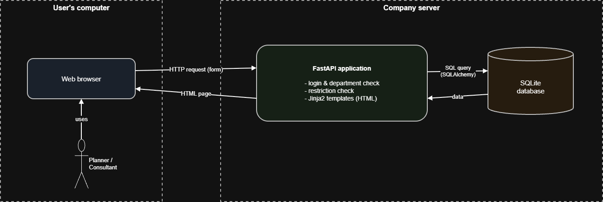

# Consultant Management System

Constraint-Aware Scheduling for Departments Working with Consulting Firms

## Project Description

Many companies work with consulting firms. Working with a consulting firm is often cheaper, and the company does not have to manage salary payments or insurance for each person. Companies can also choose the best firm and end the collaboration whenever they want. However, planning between companies and consultants is still done through meetings and manually prepared schedules. The problem is that there are many restrictions. For example, one consultant does not work on Mondays and Thursdays, and the same consultant is not available on Friday of the following week. The person who prepares the schedule has to keep all of this information in mind. My goal is to add these restrictions to a system and make this planning much easier. In this way, mistakes will be reduced, and the process will be quicker and easier.

## Objective

I want to develop an internal web application. The person who prepares the schedule will manage all of these restrictions in one place. People from the consulting firm will be able to see their tasks on a calendar and follow their work easily.

## Target Users

- **Admin:** manages the system and creates departments
- **Planner:** manages consultants, restrictions and task assignments in one department
- **Consultant:** views their own tasks on a read-only calendar

## Planned Features

- Login with three roles: admin, planner and consultant
- Department management
- Consultant management with four restriction types:
  - working weekdays
  - leave days
  - weekly day limit
  - monthly budget limit (in days)
- Task assignment with an automatic restriction check
- Read-only task view for consultants

## Scope

**Included in the first version:** login and roles, departments, consultants and restrictions, task assignment with restriction check, consultant calendar.

**Not included in the first version:** automatic e-mail invitations, AI agent, mobile application, Excel import.

## Planned Technologies

- **Backend:** Python, FastAPI, SQLAlchemy
- **Database:** SQLite
- **Frontend:** Server-rendered HTML pages with Jinja2 templates
- **Testing:** pytest
- **Deployment:** Docker (if time allows)

## Requirements

Functional and non-functional requirements are listed in the Graduation Project Report: [docs/report-draft.md](docs/report-draft.md) (sections 7 and 8).

## Architecture

The user works in a web browser. The browser sends requests to a FastAPI application on the server. FastAPI checks the login and department, runs the restriction check, reads and writes data in a SQLite database, and returns HTML pages created with Jinja2 templates.



Details: Graduation Project Report, section 12.

## How to Run

Requirements: Python (developed with 3.14.7) and Git.

```
git clone https://github.com/omerfaruksoylu/consultant-management-system.git
cd consultant-management-system/backend
python -m venv venv
venv\Scripts\python.exe -m pip install -r requirements.txt
venv\Scripts\python.exe -m uvicorn app.main:app --reload
```

Open http://127.0.0.1:8000 in a browser. The database file `backend/cms.db` and two demo consultants are created automatically on the first start. To start again with an empty task table, stop the server and delete `cms.db`.

Run the tests (from the `backend` folder):

```
venv\Scripts\python.exe -m pytest -v
```

The commands above are for Windows. On macOS or Linux, use `venv/bin/python` instead of `venv\Scripts\python.exe`.

**Note for Windows with Smart App Control:** if the start fails with `ImportError: DLL load failed while importing _util_cy`, Windows is blocking the compiled SQLAlchemy files. Delete them; SQLAlchemy then uses its pure Python versions:

```
Get-ChildItem venv\Lib\site-packages\sqlalchemy -Recurse -Filter *.pyd | Remove-Item
```

## Repository Structure

```
consultant-management-system/
├── README.md                     # Project overview (this file)
├── .gitignore
├── backend/
│   ├── requirements.txt          # Exact package versions
│   ├── pytest.ini                # Test settings
│   ├── app/
│   │   ├── main.py               # FastAPI application: pages and form handling
│   │   ├── constraints.py        # Restriction check (four restriction types)
│   │   ├── database.py           # SQLite connection and tables
│   │   └── templates/
│   │       └── index.html        # Task assignment page (Jinja2)
│   └── tests/
│       └── test_constraints.py   # Automated tests for the restriction check
└── docs/
    ├── report-draft.md           # Graduation Project Report (updated every week)
    ├── project-description.md    # Week 1: project description
    ├── references.md             # Week 1: academic and technical references
    ├── design/
    │   ├── architecture.png      # Week 3: system architecture diagram
    │   └── architecture.drawio   # Week 3: editable diagram source (draw.io)
    └── weekly-progress/
        ├── week03.md             # Week 3: progress log
        ├── week04.md             # Week 4: progress log
        └── week-04/              # Week 4: screenshots
```

## Current Status

Week 4 - First working prototype.

**Working now:** task assignment page with an automatic restriction check (FR-05). An allowed task is saved and shown in the task table; a rejected task is not saved and the reason is shown.

**Known limitations:** no login, roles or departments yet; consultants and leave days are demo data added in the code; the task table shows the consultant id instead of the name.

### Week 1 - Project definition and research
- [x] Project idea, problem and objective defined
- [x] Initial README created
- [x] Academic and technical references reviewed
- [x] Initial report sections drafted

### Week 2 - Requirements analysis and planning
- [x] Functional and non-functional requirements
- [x] Scope, constraints, assumptions and user stories
- [x] Development plan and GitHub Issues

### Week 3 - Architecture and technical design
- [x] Architecture diagram, components and system boundaries
- [x] End-to-end data flow and database design
- [x] Technology decisions (SQLite, server-rendered templates)
- [x] Report updated with system design and references

### Week 4 - First working prototype
- [x] Development environment and project structure
- [x] SQLite database with consultants, leave days and tasks
- [x] Task assignment page with restriction check (FR-05)
- [x] Normal, boundary and invalid inputs verified; one defect found and fixed
- [x] Report chapter 13 (Implementation, Stage 1)

### Next
- [ ] Week 5 - Consultant and leave day forms, login with roles, departments
