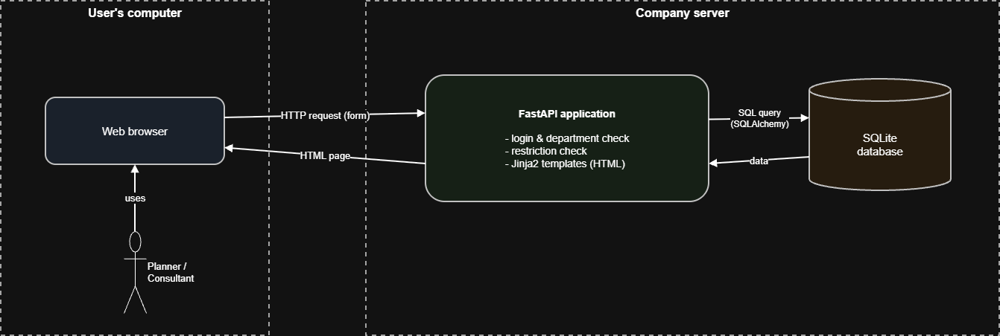
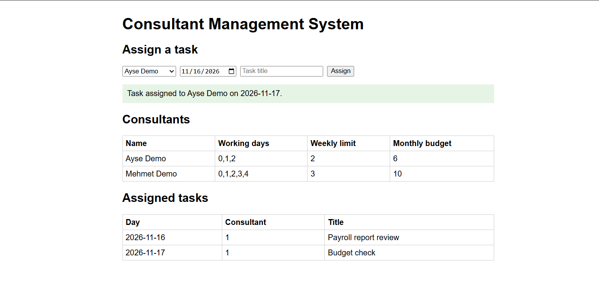
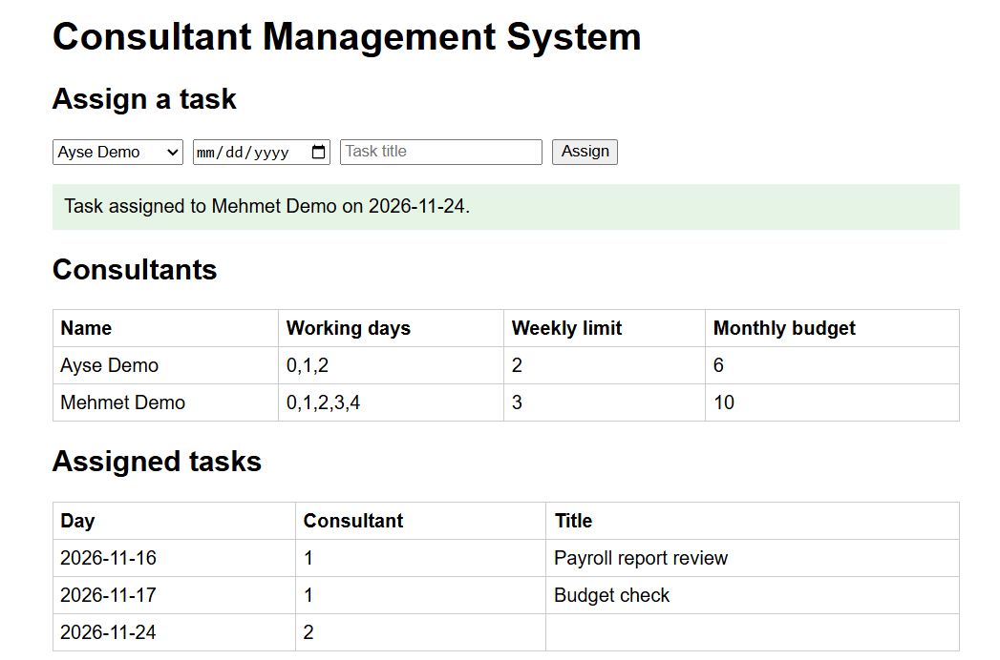
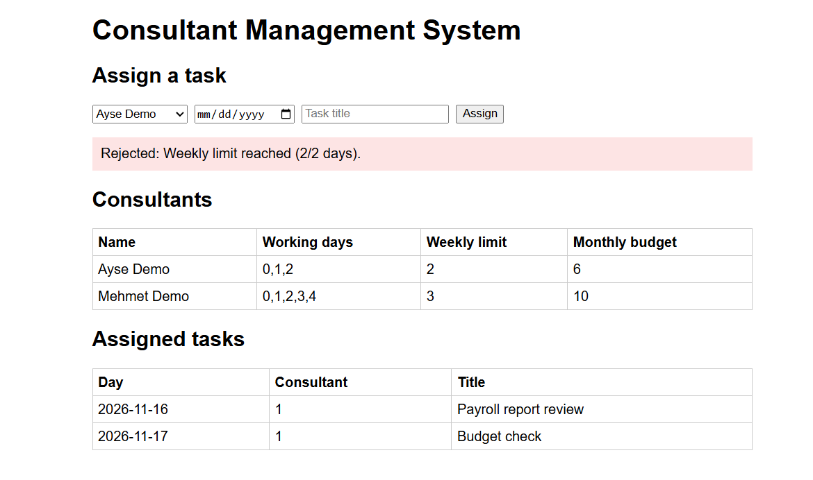
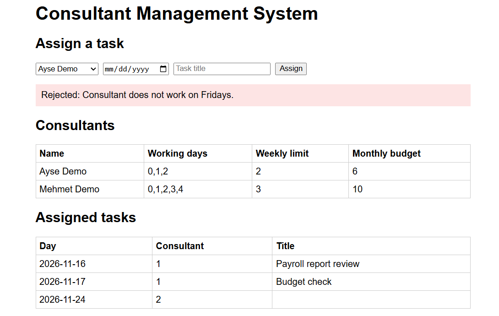
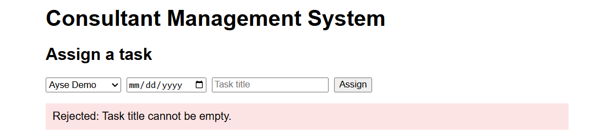

# Consultant Management System

Graduation Project Report

Student: Ömer Faruk Soylu
Repository: https://github.com/omerfaruksoylu/consultant-management-system

## 1. Introduction

Many companies work with consulting firms. Working with a consulting firm is often cheaper, and the company does not have to manage salary payments or insurance for each person. Companies can also choose the best firm and end the collaboration whenever they want.

## 2. Problem Statement

Planning between companies and consultants is still done through meetings and manually prepared schedules. The problem is that there are many restrictions. For example, one consultant does not work on Mondays and Thursdays, and the same consultant is not available on Friday of the following week. The person who prepares the schedule has to keep all of this information in mind. Research on spreadsheets also shows that mistakes in manually prepared spreadsheets are common and very hard to notice (Panko, 2015).

## 3. Motivation

My goal is to add these restrictions to a system and make this planning much easier. In this way, mistakes will be reduced, and the process will be quicker and easier. Personnel scheduling is a well-studied problem, and the restrictions used in this project belong to known constraint groups in the literature, namely time-related constraints and cost measures (Van den Bergh et al., 2013).

## 4. Project Objective

I want to develop an internal web application. The person who prepares the schedule will manage all of these restrictions in one place. People from the consulting firm will be able to see their tasks on a calendar and follow their work easily.

The system will have three types of users:

- The admin who manages the system
- The person who prepares the schedule
- Consultant firm workers

## 5. Preliminary Scope

### 5.1 Included in the first version

- Managing the restrictions of consultants
- A calendar where consultants can see their tasks

### 5.2 Not included in the first version

- In the future, the system may also send calendar invitations automatically.
- AI agents are becoming very popular. In the future, I want to add an AI agent that can manage restrictions easily. For example, restrictions could be managed through voice chat, and the agent would update the calendar automatically.

## 6. Requirements Analysis

### 6.1 Review of the Week 1 Definition

**Who is the primary user or stakeholder?**
The primary users are the people in the company who plan the work, and the consultants from the consulting firms who do the work. The system is not limited to one field: any department that works with a consulting firm, such as IT, accounting or human resources (for example for payroll), can use it. Other stakeholders are the consulting firms themselves and the company management, because they are affected by how the consultants' time and budget are used.

**What specific problem does this user have?**
As described in the problem statement, planning is done through meetings and manually prepared schedules. The planner has to remember many restrictions for each consultant, and this causes mistakes and misunderstandings.

**What is the single most important result?**
To make the planning process easier by turning it into an automated system. The planner can plan much more easily because the system checks the restrictions, and each consultant can see their own work clearly.

**Which features are essential for the first prototype?**
The tasks that are assigned must be shown correctly in a table. Small bugs are acceptable at this stage, but the main structure must work so that it can be shown to a user. Login and the calendar view can wait.

**Checkpoint**
The system is used by planners in companies that work with consulting firms, and by the consultants of these firms. Today, planning is done through meetings and manually prepared schedules, so the planner has to keep many restrictions in mind, such as working days, leave days, a weekly day limit and a monthly budget limit. This leads to mistakes and misunderstandings between the company and the consulting firm. The first version will let the planner assign tasks while the system checks these restrictions automatically, and it will show the assigned tasks in a table. Compared to Week 1, two things changed: a third user role (the planner) was added, and the restrictions were defined more clearly as four types.

### 6.2 User Roles

Table 1 shows the three user roles of the system and what each role can do.

*Table 1: User roles*

| Role | Description |
|---|---|
| Admin | Manages the system and creates departments and planner accounts. |
| Planner | Manages consultants, restrictions and task assignments in one department. |
| Consultant | Views only their own tasks on a read-only calendar. |

## 7. Functional Requirements

Table 2 lists the functional requirements. Each requirement has a priority: Must (required for the first version), Should (important but can come later) or Could (only if time allows).

*Table 2: Functional requirements*

| ID | Requirement statement | Priority |
|---|---|---|
| FR-01 | The system shall allow a user to log in with a username and password and shall show only the pages allowed for the user's role (admin, planner or consultant). | Must |
| FR-02 | The system shall allow the admin to create a department. | Must |
| FR-03 | The system shall allow the planner to add a consultant with working weekdays, a weekly day limit and a monthly budget limit (in days). | Must |
| FR-04 | The system shall allow the planner to add leave days for a consultant. | Must |
| FR-05 | The system shall reject a task assignment that falls on a non-working day or a leave day, or exceeds the weekly limit or the monthly budget, and shall display the reason. | Must |
| FR-06 | The system shall display a consultant's assigned tasks on a read-only calendar for that consultant. | Should |

## 8. Non-Functional Requirements

Table 3 lists the non-functional requirements and how each one will be verified.

*Table 3: Non-functional requirements*

| ID | Quality | Requirement | How to verify |
|---|---|---|---|
| NFR-01 | Security | User passwords shall be stored only as salted hashes, never as plain text. | Inspect the database after creating a user; an automated test checks that the stored value is different from the password. |
| NFR-02 | Security / data isolation | A planner shall not be able to view or change data that belongs to another department. | An automated test logs in as a planner of department A and checks that requests for department B data are rejected. |
| NFR-03 | Performance | The calendar of one department with 50 consultants for one month shall load within 2 seconds on the development laptop. | Measure the API response time with test data of 50 consultants. |

## 9. Scope, Constraints and Assumptions

Table 4 summarises what is included and excluded, the main project constraints and the assumptions.

*Table 4: Scope, constraints and assumptions*

| Category | Item |
|---|---|
| In scope | Login with three roles (admin, planner, consultant) |
| In scope | Managing departments, consultants and their four restriction types |
| In scope | Task assignment with automatic restriction check |
| In scope | Read-only calendar for consultants |
| Out of scope | Automatic e-mail or calendar invitations |
| Out of scope | AI agent for managing restrictions by voice or chat |
| Out of scope | Mobile application and Excel import |
| Constraint | The project must be completed in nine weeks by one developer. |
| Constraint | The developer is also attending another intensive training programme during the semester. |
| Constraint | Development and testing are done on one personal laptop. |
| Assumption | Users have a modern web browser and access to the company network. |
| Assumption | Each consultant belongs to only one department. |

The most important limitation is time. For this reason, the first version focuses on the restriction check, which is the core value of the system. Docker-based installation and live deployment will be added only if time allows.

## 10. User Stories

**US-01 — Blocking an invalid assignment** (FR-05)
As a planner, I want the system to stop me when I assign a task to a consultant on a day they cannot work, so that I do not create a wrong schedule.

Acceptance criteria:
1. Given a consultant who is on leave on 14 October, when the planner assigns a task on that day, the task is not saved.
2. The system displays the reason, for example "Consultant is on leave on 2026-10-14".

**US-02 — Respecting the monthly budget** (FR-03, FR-05)
As a planner, I want the system to count the days already assigned in a month, so that the budget agreed with the consulting firm is not exceeded.

Acceptance criteria:
1. Given a consultant with a monthly budget of 8 days and 8 assigned days in October, when the planner assigns a 9th day in October, the task is not saved and the reason is displayed.
2. When the planner assigns a task in November for the same consultant, the assignment is accepted.

**US-03 — Viewing my own tasks** (FR-01, FR-06)
As a consultant, I want to see my tasks on a calendar, so that I know where and when I work without asking the planner.

Acceptance criteria:
1. When a consultant logs in, the calendar shows only the tasks assigned to that consultant.
2. The consultant cannot create, change or delete any task.

## 11. Development Plan

Table 5 shows the planned milestone for each remaining week.

*Table 5: Development plan*

| Week | Project-specific milestone |
|---|---|
| Week 3 | Architecture diagram, database tables (departments, users, consultants, leave days, tasks) and API endpoint list |
| Week 4 | Prototype: the planner can add a consultant and assign tasks, invalid assignments are rejected with a reason, and the assigned tasks are shown in a table |
| Week 5 | Login with three roles, department data isolation and the first web pages (consultant list, task assignment) |
| Week 6 | Read-only consultant calendar and automated tests for all four restrictions and for data isolation |
| Week 7 | Installation guide with requirements files; Docker setup and live demo if time allows |
| Week 8 | Report completion, professional README and screenshots |
| Week 9 | Final demonstration and presentation |

## 12. Methodology and System Design

### 12.1 Methodology

The project follows an incremental approach. The most important part of the system, the restriction check, is developed and tested first as a separate module. After that, the web layer, the database and the login are added around it step by step. Each week ends with a small result that can be demonstrated, as shown in the development plan (Table 5). This approach fits the project because the main risk is in the restriction logic, not in the user interface, so the core is verified before the rest is built.

### 12.2 Proposed System

The goal of the system is to let a planner assign tasks to consultants while the system checks the restrictions automatically. The users are the admin, the planner and the consultant (Table 1). The main functions are department and consultant management, task assignment with a restriction check, and a read-only view of tasks for consultants.

The system has clear boundaries. Users only use a web browser on their own computer. The web application and the database run together on one server inside the company network. The system does not depend on any external service or API, and it does not send e-mails.

### 12.3 System Architecture

Figure 1 presents the proposed architecture.



*Figure 1: System architecture of the Consultant Management System*

The user opens a page in the web browser and sends a form, for example a new task assignment. The browser sends this request over HTTP to the FastAPI application on the server. FastAPI first checks who the user is and which department they belong to. If the request is a task assignment, FastAPI reads the consultant's restrictions and existing tasks from the SQLite database and passes them to the restriction check module. If the assignment is allowed, the task is saved in the database; if not, it is rejected with a reason. In both cases, FastAPI creates the result page with a Jinja2 template and sends it back to the browser as HTML. If the database cannot be reached, nothing is saved and the user sees an error message. This structure was selected because all processing happens in one place on the server, which keeps the system simple for a single developer.

Table 6 describes the responsibility of each component.

*Table 6: Component responsibilities*

| Component | Responsibility / main input | Output / connection |
|---|---|---|
| Web browser (user's computer) | Shows pages and sends forms entered by the user | HTTP requests to FastAPI |
| FastAPI application (server) | Receives requests, checks login and department, calls the restriction check, creates HTML pages with Jinja2 templates | HTML pages to the browser; read and write operations to the database |
| Restriction check module (inside FastAPI) | Receives a consultant, the existing tasks and a date; checks the four restriction types | "Allowed" or "rejected" with a reason |
| SQLite database (server) | Stores departments, users, consultants, leave days and tasks | Data to FastAPI through SQLAlchemy |

### 12.4 Example Data Flow: Assigning a Task

Table 7 follows one important use case, a planner assigning a task, from beginning to end.

*Table 7: End-to-end flow of a task assignment*

| Step | Component | Input, operation and output |
|---|---|---|
| 1 | Web browser | The planner selects a consultant, enters a task title and a date, and sends the form. |
| 2 | FastAPI application | Checks that the user is logged in as a planner and that the consultant belongs to the planner's department. Checks that the date is valid. |
| 3 | SQLite database | Returns the consultant's working days, weekly limit, monthly budget, leave days and existing tasks. |
| 4 | Restriction check module | Checks the four restriction types. If one fails, it returns the reason, for example "Consultant is on leave on 2026-10-14". |
| 5 | FastAPI application | If allowed, saves the task and shows the updated task table. If rejected, does not save anything and shows the reason on the page. |

Failure case: if the database is not available in step 3, the task is not saved and the planner sees an error message asking them to try again.

### 12.5 Data Design

The data entered into the system are departments, users, consultants with their restrictions, leave days and tasks. All data are stored in one SQLite database file on the server. Only demo data with invented names will be used during development. Passwords are stored as salted hashes (NFR-01). Table 8 shows the planned tables and their key fields.

*Table 8: Planned database tables*

| Table | Key fields |
|---|---|
| departments | id, name |
| users | id, username, password_hash, role (admin / planner / consultant), department_id, consultant_id (only for consultants) |
| consultants | id, name, department_id, working_weekdays, weekly_limit, monthly_budget_days |
| leave_days | id, consultant_id, date |
| tasks | id, consultant_id, title, date |

### 12.6 Requirements-to-Design Traceability

Table 9 shows how the most important requirements from Week 2 are handled in the design.

*Table 9: Requirements-to-design traceability*

| ID | Requirement in my project | Design response / component |
|---|---|---|
| FR-03 | Add a consultant with working weekdays, a weekly limit and a monthly budget | consultants table and a consultant form page in FastAPI |
| FR-05 | Reject an assignment that breaks a restriction and show the reason | Restriction check module, called by FastAPI before a task is saved |
| FR-06 | Show a consultant their own tasks (read-only) | A page that only lists tasks where the consultant id matches the logged-in user |
| NFR-01 | Passwords stored as salted hashes | Login part of FastAPI hashes passwords before saving them in the users table |
| NFR-02 | A planner cannot see another department's data | Every database query is filtered by the logged-in user's department in one central function |

### 12.7 Technology Selection

FastAPI was selected for the backend because it checks incoming data automatically using Python type hints and creates an interactive test page, which reduces the amount of code (FastAPI, n.d.-a). Table 10 records two important technology decisions.

*Table 10: Architecture decision records*

| | ADR-01 | ADR-02 |
|---|---|---|
| Issue | How should the user interface be built? | Which database should be used? |
| Selected option | Server-rendered pages with Jinja2 templates in FastAPI | SQLite |
| Alternative | React as a separate frontend application | PostgreSQL |
| Reason / trade-off | Everything stays in one language (Python) and one project, which fits a single developer with limited time. The trade-off is that pages are less interactive than in React (Meta Open Source, n.d.). | SQLite needs no installation or separate server and stores everything in one file. Its trade-off is weaker support for many users writing at the same time, which is acceptable for one department's planners (SQLite, n.d.). Because SQLAlchemy is used, a later move to PostgreSQL is possible. |
| Reference | FastAPI (n.d.-b) | SQLite (n.d.) |

### 12.8 Design Risks and Week 4 Prototype

Table 11 lists two realistic risks and how they will be handled early.

*Table 11: Design risks and mitigation*

| Risk | Potential impact | Mitigation / verification |
|---|---|---|
| R1: Week, month or date calculations in the restriction check are wrong | Invalid assignments could be accepted, which breaks the main goal | Automated tests for each restriction type, including edge cases such as a new week or a new month |
| R2: A planner can see data of another department | Private planning data could leak between departments | One central department filter for all queries and an automated test that tries to access another department's data |

**Week 4 prototype goal:** In Week 4, I will demonstrate a task assignment page, where the planner's form passes through FastAPI and the restriction check module to produce either a new row in the task table or a rejection message with the reason. A screenshot of both cases and the test output will prove that it works.

### 12.9 Changes Since Week 2

Two changes were made after the Week 2 requirements. First, the user interface will be built with server-rendered templates instead of React (ADR-01). Second, the calendar download as an .ics file (former FR-07, priority Could) was removed from the first version. Both changes were made to keep the project realistic for one developer within nine weeks. The Must requirements did not change.

## 13. Implementation

### 13.1 Implementation Overview

In Week 4, I implemented the first working prototype of the system. It covers FR-05, which is the main requirement of the project: the system must reject a task assignment that breaks one of the four restriction types and show the reason. The prototype is a single web page. The planner selects a consultant, enters a date and a task title, and sends the form. The system checks the restrictions. If the assignment is allowed, the task is saved in the database and appears in the task table. If it is not allowed, nothing is saved and the reason is shown on the page.

The prototype has clear boundaries. It has no login, roles or departments yet (FR-01, FR-02, NFR-01, NFR-02). Consultants and leave days cannot be added from the interface yet (FR-03, FR-04); two consultants with invented names ("Ayse Demo" and "Mehmet Demo") and one leave day are added automatically when the application starts for the first time. These parts are planned for Week 5.

### 13.2 Development Environment and Technologies

Table 12 lists the actual tools and versions used in Week 4. The exact package versions are saved in `backend/requirements.txt`, so the same environment can be created on another computer.

*Table 12: Development environment*

| Tool / library | Version | Role in the project |
|---|---|---|
| Windows 11, VS Code | – | Operating system and code editor |
| Python | 3.14.7 | Programming language |
| FastAPI | 0.163.1 | Web framework: receives requests and calls the right function |
| Uvicorn | 0.54.0 | Server that runs the FastAPI application on http://127.0.0.1:8000 |
| SQLAlchemy | 2.1.8 | Connects Python code to the database |
| SQLite | (included in Python) | Database stored in one file, `backend/cms.db` |
| Jinja2 | 3.1.6 | Creates the HTML page from a template and Python data |
| python-multipart | 0.0.34 | Needed by FastAPI to read HTML form data |
| pytest | 9.2.0 | Runs the automated tests |
| Git, GitHub | – | Version control and project history |

All packages are installed in a virtual environment (`backend/venv`), which keeps the project's packages separate from other Python projects on the same computer. The `venv` folder and the database file are excluded from the repository with `.gitignore`. The technology choices follow the decisions in section 12.7 (ADR-01 and ADR-02).

### 13.3 Prototype Implementation

The prototype follows the architecture in section 12.3. Table 13 shows the main files and their responsibilities.

*Table 13: Source files of the prototype*

| File | Responsibility |
|---|---|
| `backend/app/constraints.py` | Restriction check module. The function `check_assignment` checks the four restriction types in order and returns the first one that fails. It has no database or web code, so it can be tested on its own. |
| `backend/app/database.py` | Database connection and three tables: `consultants`, `leave_days` and `tasks`. The tables are created automatically when the application starts. |
| `backend/app/main.py` | FastAPI application. `GET /` shows the page. `POST /tasks` receives the form, reads the consultant's data from the database, calls the restriction check and saves the task if it is allowed. |
| `backend/app/templates/index.html` | Jinja2 template: the form, the result message, the consultant table and the task table. |
| `backend/tests/test_constraints.py` | Five automated tests: one allowed case and one test for each restriction type. |

The flow of one task assignment is the same as in Table 7, without the login and department checks in step 2:

1. **Input:** the planner selects "Ayse Demo", enters 2026-11-17 and the title "Budget check", and clicks "Assign". The browser sends a POST request to `/tasks`.
2. **Processing:** FastAPI converts the form fields into Python values (a number, a date and a text). `main.py` reads the consultant's working days, limits, leave days and existing tasks from SQLite and passes them to `check_assignment`.
3. **Output:** the assignment is allowed, so the task is saved and the page shows "Task assigned to Ayse Demo on 2026-11-17." in a green box (Figure 2). When a restriction is broken, the page shows the reason in a red box (Figures 3 and 4).



*Figure 2: An allowed assignment. The task is saved and appears in the task table.*

Figure 2 shows that the whole flow works: the form data reached FastAPI, passed the restriction check and was saved in the database, because the new row appears in the task table.



*Figure 3: Rejection because the consultant does not work on Fridays*



*Figure 4: Rejection because the weekly limit (2 days) is already reached*

Figures 3 and 4 show that a rejected assignment is not saved: the task table does not change, and the reason from the restriction check module is displayed to the planner.

The restriction check module was also tested automatically. The output of the test run on my computer was:

```
platform win32 -- Python 3.14.7, pytest-9.2.0, pluggy-1.7.0
configfile: pytest.ini
testpaths: tests
collected 5 items

tests/test_constraints.py::test_allowed PASSED
tests/test_constraints.py::test_non_working_day PASSED
tests/test_constraints.py::test_leave_day PASSED
tests/test_constraints.py::test_weekly_limit PASSED
tests/test_constraints.py::test_monthly_budget PASSED

5 passed in 0.03s
```

**Verification.** Table 14 lists the inputs that I tried in the running application, including normal, boundary and invalid inputs.

*Table 14: Verification of the prototype*

| No | Input | Expected result | Actual result |
|---|---|---|---|
| P01 | Ayse Demo, 2026-11-16 (Monday), "Payroll report review" | Allowed | Allowed, task saved |
| P02 | Ayse Demo, 2026-11-17 (Tuesday), "Budget check" | Allowed (second day of the week) | Allowed, task saved (Figure 2) |
| P03 | Ayse Demo, 2026-11-20 (Friday) | Rejected: non-working day | Rejected: "Consultant does not work on Fridays." (Figure 3) |
| P04 | Ayse Demo, a third day in the same week (boundary: weekly limit is 2) | Rejected: weekly limit | Rejected: "Weekly limit reached (2/2 days)." (Figure 4) |
| P05 | Leave day | Rejected: leave day | Covered by the automated test `test_leave_day` |
| P06 | Mehmet Demo, 2026-11-24, title containing only spaces | Rejected: empty title | **Defect:** the task was saved without a title (Figure 5). Corrected, see section 13.4 (Figure 6). |

### 13.4 Technical Challenges and Solutions

**Challenge 1: Windows blocked a part of SQLAlchemy.** After the database code was added, the application did not start. The error was:

```
from sqlalchemy import select
...
ImportError: DLL load failed while importing _util_cy:
Uygulama Denetimi ilkesi bu dosyayı engelledi.
```

The message means "the Application Control policy blocked this file". SQLAlchemy includes compiled `.pyd` files that make some operations faster, and the Smart App Control feature of Windows on my computer blocked them. I considered two solutions. Turning off Smart App Control was rejected, because it lowers the security of the computer and cannot be turned on again without resetting Windows. Instead, I deleted the eight `.pyd` files inside `venv\Lib\site-packages\sqlalchemy`. SQLAlchemy also contains the same code as normal Python files and uses them when the compiled files are missing. After this, the application started without errors. The cost is a small loss of speed, which is not noticeable with the small amount of data in this project. Because the files come back when the packages are reinstalled, this step was added to the README.

**Challenge 2: A task without a title was accepted (P06).** The title field in the form has the HTML attribute `required`, so an empty field cannot be sent. However, when I typed only spaces, the browser accepted the field as filled, and the task was saved without a visible title (Figure 5). The reason is that Python treats a text that contains only spaces as a non-empty value. I added a check in `main.py` that removes the spaces at the beginning and end of the title (`title.strip()`) and rejects the assignment if nothing remains. The check is done on the server, because the browser check can be bypassed by sending a request without the form. After the fix, the same input is rejected with "Task title cannot be empty." (Figure 6), and normal assignments still work. The fix is in commit `86b5699`.



*Figure 5: Before the fix. A task containing only spaces as its title was saved (row 2026-11-24).*



*Figure 6: After the fix. The same input is rejected with a clear message.*

### 13.5 Development Process — Stage 1

*Table 15: Development Stage 1 record*

| Field | Description |
|---|---|
| Date | 16 November 2026 |
| Objective | Demonstrate that the selected approach (FastAPI, Jinja2, SQLAlchemy and SQLite) works for the main workflow of the system (FR-05). |
| Implemented feature | Task assignment page: form → restriction check → task saved or rejected with the reason. Database with three tables and demo data. |
| Technical decision | The restriction check is kept in a separate module (`constraints.py`) without database or web code. The web part only reads the data and calls it. This makes the rules testable without starting the server and keeps them in one place. |
| Problem | (1) Windows Smart App Control blocked compiled SQLAlchemy files. (2) A title containing only spaces was accepted. |
| Solution | (1) Removed the compiled files so SQLAlchemy uses its Python versions. (2) Added a server-side check for an empty title. |
| Commits | `1c9b5ac` project set-up; `a556657` restriction check and tests; `a044845` task assignment page; `86b5699` empty title fix |
| Evidence | Figures 2–6, Table 14, test output in section 13.3 |
| Next step | Week 5: forms for adding consultants and leave days, login with three roles and department separation. |

### 13.6 Limitations and Next Steps

The prototype has the following known limitations:

- There is no login, so anyone who opens the page can assign tasks. Roles and departments are planned for Week 5 (FR-01, FR-02, NFR-01, NFR-02).
- Consultants and leave days can only be added in the code (demo data), not from the interface (FR-03, FR-04).
- The task table shows the consultant's id instead of the name.
- If the form is sent with a consultant id that does not exist (possible only without the browser form), the server returns an error (HTTP 500) instead of a clear message. This will be handled in Week 5 as part of input validation.
- Week 5 will continue with the remaining Must requirements. Table 16 shows the status of the requirements at the end of Week 4.

*Table 16: Requirement status at the end of Week 4*

| ID | Week 4 status | Week 5 target |
|---|---|---|
| FR-01 Login and roles | Not implemented | Implement |
| FR-02 Departments | Not implemented | Implement |
| FR-03 Add consultant | Database table ready; no form (demo data only) | Implement the form |
| FR-04 Add leave days | Database table ready; no form (demo data only) | Implement the form |
| FR-05 Restriction check | Implemented and verified | Improve input validation |
| FR-06 Consultant view | Not implemented | Week 5 or 6 |
| NFR-01 Password hashing | Not implemented | Implement with login |
| NFR-02 Department isolation | Not implemented | Implement with departments |
| NFR-03 Performance | Not evaluated | Week 6 |

## References

FastAPI. (n.d.-a). *FastAPI*. Retrieved November 13, 2026, from https://fastapi.tiangolo.com/

FastAPI. (n.d.-b). *Templates*. Retrieved November 13, 2026, from https://fastapi.tiangolo.com/advanced/templates/

Meta Open Source. (n.d.). *Learn React*. Retrieved November 13, 2026, from https://react.dev/learn

Panko, R. R. (2015). What we don't know about spreadsheet errors today: The facts, why we don't believe them, and what we need to do. In *Proceedings of the EuSpRIG 2015 Conference*. European Spreadsheet Risks Interest Group. https://arxiv.org/abs/1602.02601

SQLite. (n.d.). *Appropriate uses for SQLite*. Retrieved November 13, 2026, from https://www.sqlite.org/whentouse.html

Van den Bergh, J., Beliën, J., De Bruecker, P., Demeulemeester, E., & De Boeck, L. (2013). Personnel scheduling: A literature review. *European Journal of Operational Research, 226*(3), 367–385. https://doi.org/10.1016/j.ejor.2012.11.029
